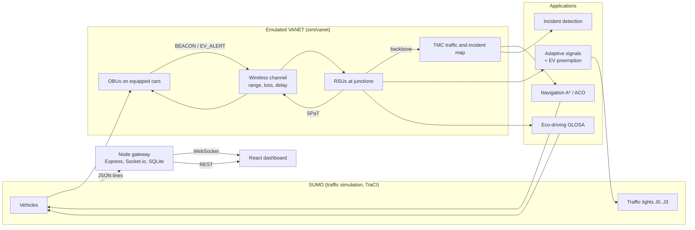

# VANET-Based Intelligent Traffic Signal Control

A web-based traffic simulation in which an emulated **VANET** (vehicles with on-board units, roadside units at
junctions, V2V/V2I messages with range, loss and delay) drives the decisions:

- **Adaptive signals** that read queues the roadside units estimate from vehicle beacons.
- **Ambulance preemption** over V2I/V2V alerts. Only the ambulance's approach gets green, reached safely via yellow and all-red.
- **Navigation** with A\* heuristic search and ant colony optimisation (ACO) on the VANET traffic map.
- **Incident detection** from beacons (stopped vehicles), with rerouting and signal reaction.
- **Eco-driving (GLOSA):** roadside units broadcast signal timing (SPaT) and eco cars get speed advice to arrive on green.
- **Offline GA tuning** of signal/VANET and ACO parameters, and a multi-seed **evaluation** with statistics.
- **Live web dashboard:** traffic map, follow a car, its advice, fuel and CO₂, junction cards, VANET and navigation panels, results. One shared stream for 1000+ viewers.

Simulation: **SUMO** controlled through TraCI on a **2×2 signalised grid** (and a single junction for early tests).
The network layer is emulated in Python; there is no OMNeT++.



---

## 1. Install

**Requirements:** Python 3.10+, Eclipse SUMO 1.18+ (tested with 1.28), Node.js 18+ (tested with 24), Git.

**SUMO_HOME** must point to the SUMO installation:
- Windows (PowerShell): `$env:SUMO_HOME = "C:\Program Files (x86)\SUMO"` (set it permanently in *System → Environment variables*)
- Linux: `export SUMO_HOME=/usr/share/sumo` (add it to `~/.bashrc`)

Then, from the project folder:
```bash
npm run setup
```
This creates `.venv`, installs `sim/requirements.txt`, runs `npm install` in `server/` and `client/`, and writes
`server/.env`. The `.env` gets the venv's Python and a random `ADMIN_TOKEN`; open it to see or change the token.

Check SUMO and TraCI: `.venv/Scripts/python.exe sim/smoke_test.py` (Linux: `.venv/bin/python sim/smoke_test.py`).

## 2. Run the live demo

| Command | What it does |
|---|---|
| `npm run dev:mock` | Gateway with the **mock** simulation (no SUMO needed) + dashboard dev server: http://localhost:5173 |
| `npm run dev` | Same with the **real SUMO** simulation |
| `npm start` | Builds the dashboard and serves everything from the gateway: http://localhost:4000 |

Pages:
- `/`: **My drive**. Traffic map; tap a car to follow it and see its next light, countdown, eco advice, fuel and CO₂.
- `/live`: junction cards, VANET and navigation panels, charts, event log.
- `/results`: experiment results.
- `/admin`: start/stop runs; needs `ADMIN_TOKEN` from `server/.env`.

With `LIVE_LOOP=true` (in `server/.env`) the playlist in `server/playlist.json` loops through baseline,
VANET-adaptive, ambulance, eco-driving, A\*, ACO and road closure.

**See it in SUMO-GUI.** Click **Open in SUMO-GUI** in the dashboard's top bar. It's shown only to a browser on the same computer as the gateway. The current run restarts in SUMO's own window; click again to close it. Or set `SIM_GUI=true` in `server/.env`, or run one simulation directly:
```bash
.venv/Scripts/python.exe sim/main.py --scenario emergency --network grid2x2 --controller adaptive_ev_vanet --eco-fraction 0.6 --gui
```
SUMO-GUI draws roads 1.6× and cars 1.3× wider than real so they are easy to see (`sim/sumo/gui-settings*.cfg.xml`).
The simulation always uses real sizes.

## 3. Command line (one simulation)

```bash
python sim/main.py --scenario <normal|congested|emergency|incident|navigation> --controller <controller>
                   [--network single|grid2x2] [--nav none|astar|aco|aco_tuned] [--seed 1]
                   [--penetration 0.5] [--loss 0.1] [--range 300] [--relay on|off] [--nav-fraction 0.3]
                   [--eco-fraction 0.6] [--gui] [--live] [--step-delay 0.25] [--max-steps 600]
```
- **Controllers:**
  - `fixed`, `adaptive` (true queues), `adaptive_vanet` (VANET queues);
  - `adaptive_ev` (+ preemption from true EV positions), `adaptive_ev_vanet` (+ preemption over V2I/V2V);
  - `adaptive_ev_vanet_tuned` (GA-tuned).
- **Output:** without `--live` it prints one JSON results dict (waiting/travel times, EV travel time, PDR, missed preemptions, navigation, incident, fuel/CO₂ and eco fields). With `--live` it prints the JSON-lines protocol (see `PROJECT_CONTEXT.md`).

## 4. Experiments (headless, outside the web UI)

| Command | What it does | Time (8 workers) |
|---|---|---|
| `npm run sim:tune` | GA tuning, signals then ACO, held-out check on seeds 1-10 → `results/ga/` | about 45 min each |
| `npm run sim:experiments:quick` | All suites, 2 seeds, short runs → `results/quick/` | about 5 min |
| `npm run sim:experiments` | Full evaluation: suites signals, ev, nav, eco; 10 seeds → `results/summary.json`, `summary.md`, plots | 1-2 h |

The evaluation resumes where it stopped (`results/raw.csv`). It prints a runtime estimate first, and configurations
that need GA output are skipped until `npm run sim:tune` has run. The Results page reads `results/summary.json`.
`npm run sim:report` regenerates the tables in `docs/results_discussion.md` from those files. The discussion
paragraphs there are written by hand, so regenerating replaces them with placeholders.

**Main results** (2×2 grid, 10 seeds, 1000 s runs; full tables in `results/summary.md`, discussion in
[docs/results_discussion.md](docs/results_discussion.md)):

| Question | Result |
|---|---|
| Adaptive signals with VANET sensing | Waiting time −36 to −39% vs fixed-time from 80% penetration (oracle −38%); worse than fixed-time at 20% |
| Ambulance preemption over VANET | Ambulance travel time −25 to −27% vs adaptive at 0-50% packet loss, same as oracle; 0 missed junctions |
| Navigation (A\*, ACO) | Navigating cars 0-12% faster than others; network-wide −6% with an incident (A\*, 50%), neutral without |
| Eco-driving (GLOSA) | Fixed-time signals, all cars eco: stops −40%, waiting −31%, CO₂ −3%; almost no effect with adaptive signals |
| GA tuning on held-out seeds | ACO −27 to −40% fitness (10/10 seeds); signals −1.5 to −3.8%, not significant |

## 5. Tests

`npm test` runs the Python tests (pytest), the gateway tests (vitest + supertest + socket.io-client, with the
mock) and the dashboard tests. `npm run test:e2e` runs an end-to-end test with the **real** SUMO simulation:
ambulance run through the admin API, states, alerts, preemption, stored result.

## 6. Configuration

- **Simulation:** `sim/config.yaml` (controllers, VANET, eco, navigation, ACO, GA, evaluation) and `sim/scenarios/*.yaml`.
- **Gateway:** `server/.env`, documented in `server/.env.example` and [server/README.md](server/README.md). The main ones:

| Variable | Meaning |
|---|---|
| `PYTHON_BIN` | Python with the requirements; a relative path is relative to `server/` |
| `USE_MOCK` | `true` = mock simulation, no SUMO |
| `ADMIN_TOKEN` | Required for start/stop (header `X-Admin-Token`) |
| `LIVE_LOOP` | Loop `server/playlist.json` |
| `SIM_STEP_DELAY` | Wall-clock seconds per simulated second for live runs (default 0.25) |
| `SIM_GUI` | Open live runs in SUMO-GUI from the start |
| `PORT`, `HOST` | Listen address (default 4000, 0.0.0.0) |

## 7. API (gateway)

REST:
- `GET /api/health`, `/api/live/status`, `/api/live/playlist`, `/api/options`
- `GET /api/experiments/summary`, `/api/runs`, `/api/runs/:id`, `/api/metrics`
- `GET` / `POST /api/sumo/gui`
- admin: `POST /api/live/start`, `POST /api/live/stop`

Socket.io (room `live`): `init`, `state`, `event`, `status`, `result`, `now_playing`, `viewers`, `network`, `vehicles`,
`vehicle` (after `follow`). Full reference: [server/README.md](server/README.md).

## 8. Repository

```
PROJECT_CONTEXT.md   project rules, interfaces and protocol
package.json         root scripts (setup, dev, test, experiments)
scripts/             setup.mjs, py.mjs
sim/                 SUMO + Python simulation
  sumo/              networks (net.xml single junction, grid2x2.net.xml), GUI settings
  sensing.py         StateProvider (oracle) interface
  vanet/             channel, messages, nodes (RSU/TMC), network, alerts, glosa (eco-driving), sensing_vanet
  navigation/        graph, astar, aco, navigator
  controllers/       base, fixed, adaptive, preemption
  optimizer/         ga_tuner
  analytics/         metrics, plots, evaluate, vanet_experiments
  scenarios/         *.yaml, generate_routes, route_alternatives, incident
  runner.py main.py mock_sim.py mock_traffic.py live_vehicles.py config.yaml
  tests/             pytest
server/              Node gateway (src/, test/, loadtest/, playlist.json)
client/              React dashboard (src/pages, src/components, src/hooks, src/lib)
results/             experiment outputs (summary.json, summary.md, plots, ga/)
docs/                method.md, demo_script.md, results_discussion.md
```

## 9. Windows and Linux notes

- **Python:** `python` on Windows, `python3` on Linux. The scripts use the `.venv` interpreter automatically.
  - Windows: `.venv\Scripts\python.exe`. Linux: `.venv/bin/python`.
- **Paths:** nothing is hard-coded; SUMO is found through `SUMO_HOME`. Use forward slashes in `.env` paths on both systems.
- **Ports:**
  - The gateway listens on 4000 and the Vite dev server on 5173.
  - On Windows, allow Node.js through the firewall the first time if other computers should connect.
  - On Linux, open the port (`sudo ufw allow 4000`).
- **Many viewers (Linux):** raise the open-file limit (`ulimit -n 65535`). The nginx reverse-proxy config is in [server/README.md](server/README.md).
- **libsumo:** it may not load on Windows; the simulation then falls back to TraCI automatically (slower, same results).

## 10. Limitations

- **Emulated channel, not a network simulator.** The VANET is emulated: distance-based loss, delay and jitter, but no MAC contention or interference. A full network simulator (OMNeT++/Veins) would be more faithful.
- **Small network.** The 2×2 grid offers few alternative routes, so navigation gains are small.
- **A\* = Dijkstra in path quality.** A\* returns the same optimal path as Dijkstra for the same edge costs. Its gain is fewer node expansions; the contribution here is the VANET-derived edge costs and the comparison with ACO.
- **Eco-driving needs predictable signals.** GLOSA helps most with fixed-time signals. Adaptive control and preemption make the timing uncertain, so the advisor gives less advice.
- **Estimates only.** Fuel and CO₂ come from SUMO's HBEFA4 emission model.
- **Simplified emergency vehicles.** Other cars do not form a rescue lane (no SUMO bluelight device), and ambulances obey red lights. Preemption is what clears their way.
