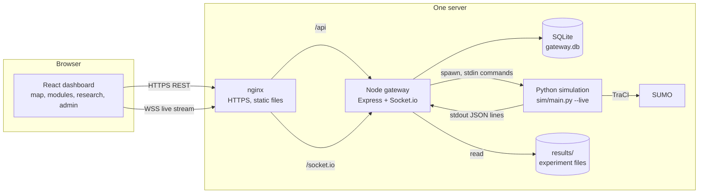

# Platform architecture

How the web platform around the simulation is built. The simulation itself (road network, signal
controllers, VANET emulation, navigation, incidents, GLOSA, GA tuning, work zone) is explained in
[`docs/PROJECT_OVERVIEW.md`](../PROJECT_OVERVIEW.md) and [`docs/method.md`](../method.md).

## 1. Components



| Part | Code | Job |
|---|---|---|
| Dashboard | `client/` (React 18, Vite, React Router 7, Recharts) | Live traffic map, module pages, research dashboards, guided demo, account and administration pages |
| Gateway | `server/src/` (Node, Express 5, Socket.io 4, better-sqlite3, zod, helmet) | Accounts and sessions, roles, REST API, one shared live stream, simulation lifecycle, persistence |
| Simulation | `sim/` (Python, TraCI) | Runs SUMO and the research algorithms; in live mode prints one JSON line per message |
| Database | `server/data/gateway.db` (SQLite, WAL) | Accounts, sessions, audit log, settings, runs, results, events, state samples, driver trips ([DATABASE.md](DATABASE.md)) |
| Experiment results | `results/` | Offline multi-seed evaluation and GA output, read by the research pages; never written by the gateway |

## 2. One shared simulation

There is exactly one live simulation, and every viewer watches the same one; viewers never start
their own.

- `LiveChannel` (`server/src/liveChannel.js`) owns the Python process. It parses its output, keeps
  the latest state, the last 120 simulated seconds as chart rows and the last 200 events, and
  broadcasts to the Socket.io room `live`.
- **Broadcast pacing:**
  - `state`: at most one per second, *volatile* (a slow client skips a frame instead of queueing it).
  - `vehicles` (the map frame): at most one per second, 150 ms after the state.
  - Events, status and results are sent reliably.
- **Following a car** is a subscription to the room `veh:<id>`; only its followers get that car's
  details.
- **A new or reconnecting viewer** first gets `init`: road network, current map frame, full latest
  state, chart history, recent events, now-playing and driver seat. That is about 64 KB with a full
  history ([Phase 9](../testing/PHASE_9_REPORT.md)).
- **The playlist** (`server/playlist.json`) plays runs one after another when `LIVE_LOOP=true`.
  Administrators, and researchers for their own runs, can start or stop a run with chosen options.

The simulation's output in live mode is additive display data (signal timing, road speeds,
incidents, ambulance routes, VANET range). It does not change any control decision. The regression
test (`sim/tests/test_regression.py`) checks that 12 reference runs give exactly the stored results.

## 3. Simulation lifecycle

```
STOPPED → STARTING → RUNNING → STOPPING → STOPPED
              ↘ FAILED (start failed, crash, exit without a result)
                  ↘ RECOVERING (playlist waits CRASH_RETRY_MS, then the next entry)
                  → after MAX_SIM_FAILURES failed runs in a row: stays FAILED until someone starts a run
```

- One start or stop at a time: `exclusive()` answers a concurrent request with 409 `busy`.
- `RUNNING` is shown only after the first state arrives from the simulation, so the dashboard never
  shows a run as live that has not started.
- When the gateway stops, the whole Python + SUMO process tree is ended. At start-up, runs left
  `running` by a crash are marked `interrupted`.
- **Playback.** While `RUNNING`, the run can be paused, resumed, or played at 0.5×, 1×, 2× or 4×
  speed, and restarted from its first second (`sim/commands.py`, `Playback`).
  - The commands travel to Python on stdin. Python confirms each change with a `playback`
    message, and only the confirmed state is shown to viewers (`now_playing.playback`).
  - Only the wall-clock pacing changes; while paused, SUMO is not stepped. A test compares a
    paused and re-speeded real SUMO run with an undisturbed one: identical states, second by
    second, and identical results (`sim/tests/test_playback.py`).

## 4. Security model

| Layer | Mechanism |
|---|---|
| Identity | E-mail + password; Argon2id hashes (19 MiB, 2 passes; scrypt on Node versions without Argon2), at most 2 hashed at once off the main thread |
| Session | Random 256-bit token in an `HttpOnly`, `SameSite=Lax` cookie (`Secure` in production); only its SHA-256 is stored; expiry `SESSION_TTL_HOURS`; at most `SESSIONS_PER_USER` per account; ended by sign-out, password change or reset, disabling, or an administrator |
| Roles | `VIEWER` (watch, research pages, follow a car, the driver seat), `RESEARCHER` (also start and stop own runs), `ADMIN` (users, sessions, audit, settings, any run, driver mode, SUMO-GUI). Checked by the gateway on every route and socket event; the dashboard only hides what a role cannot use |
| Requests | CSRF token header on every write; browser `Origin` must be this site (API and socket); zod validation of every body; 10 KB body limit; rate limits per address; account lockout after `LOGIN_MAX_FAILS` |
| Responses | helmet: CSP (scripts only from this site, live connections only to this host), HSTS in production, `nosniff`, no framing; errors as `{error, code}` without internals |
| Capacity | At most `MAX_CONNECTIONS` (1,000) live connections; more get `capacity` and the dashboard retries |
| Audit | Sign-ins and failures, account changes, resets, settings, run starts and stops, refused actions; no passwords or hashes |

## 5. Data flow of one simulated second

1. SUMO advances one step; the Python controllers read the VANET's view and set the signals.
2. Python prints a `state` line (metrics, every junction's phase, queues, SPaT, VANET and
   navigation figures) and a `vehicles` line (`[id, x, y, angle, flags]` for every car).
3. The gateway validates each line. Bad lines are counted and dropped; every 2 simulated seconds a
   state sample is stored.
4. The gateway broadcasts the state and the map frame to the room `live`, and the followed car's
   details to its followers.
5. The dashboard merges the frames. The map animates cars between positions, and charts redraw
   once per second.

## 6. Repository layout (platform parts)

```
client/            React dashboard (src/pages, src/components, src/hooks, src/lib)
server/src/        gateway: app.js (routes), auth.js, liveChannel.js, driver.js, db.js, config.js, protocol.js
server/test/       gateway tests (vitest)          server/loadtest/  load and size measurements
sim/               simulation (unchanged algorithms; live display output in runner.py, live_vehicles.py)
tests/e2e/         browser tests (Playwright + Edge)  tests/deploy/  production-configuration check
deploy/            production settings, systemd unit, nginx site, backup script
docs/              architecture/, deployment/, testing/, guides/, research/
```

## 7. Design decisions

| Decision | Reason |
|---|---|
| SQLite instead of PostgreSQL | One gateway is the only writer; file-level online backup; no separate server to run. PostgreSQL becomes necessary only with several gateways |
| Cookie sessions instead of JWT | Revocable at once (sign-out, disabling, password change end the live sockets too); the token never reaches JavaScript |
| One gateway, no Redis | 1,000 viewers used about 10 % of one core in the load test; a second gateway would need a Redis adapter, a shared connection count and a shared database |
| Uncompressed Socket.io, gzip for HTTP | Compressing each broadcast once per viewer would cost CPU per viewer; the first message was made small instead |
| Python stays a child process | The simulation keeps its tested code path; the gateway only reads its output and sends driver commands |
