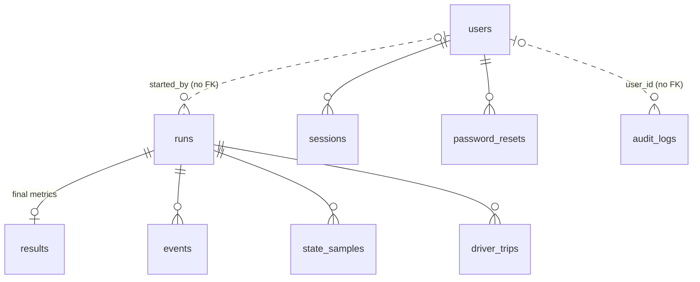

# Database schema

SQLite file at `DB_PATH` (default `server/data/gateway.db`), WAL journal, foreign keys on, 5 s busy
timeout. The schema is created and upgraded by versioned migrations in
[`server/src/db.js`](../../server/src/db.js) (§3). All times are ISO 8601 UTC text.

## 1. Tables

### Simulation records (migration 1, 2, 3)

**`runs`**: one row per live run.

| Column | Type | Notes |
|---|---|---|
| `id` | TEXT PK | `live-<time>-<random>` |
| `scenario`, `controller`, `nav` | TEXT | run options |
| `seed` | INTEGER | |
| `penetration`, `loss` | REAL | share of VANET-equipped cars; packet loss rate |
| `relay` | TEXT | `on` / `off` (V2V relay of ambulance alerts) |
| `eco_fraction` | REAL | share of eco (GLOSA) cars (migration 2) |
| `ev_routing` | TEXT | ambulance route choice `on` / `off` (migration 2) |
| `source` | TEXT | `admin` (started by a user) or `playlist` |
| `status` | TEXT | `running`, `finished`, `stopped`, `error`, `interrupted` |
| `message` | TEXT | reason for `stopped` / `error` / `interrupted` |
| `started_at`, `ended_at` | TEXT | |
| `started_by` | INTEGER | user id of the starter (migration 3; no foreign key, so it survives user deletion) |

Index: `idx_runs_started (started_at)` for the newest-first run list.

**`results`**: the final metrics of a run that finished (`run_id` PK → `runs.id` ON DELETE CASCADE,
`metrics` JSON text, `created_at`).

**`events`**: signal and incident events of a run (`id` PK, `run_id` → `runs.id` CASCADE, `t` simulated
second, `kind`, `tls` junction, `detail`, `created_at`). Index `idx_events_run (run_id, id)`.

**`state_samples`**: one complete state message every `SAMPLE_EVERY_SIM_S` (2) simulated seconds (`id`
PK, `run_id` → `runs.id` CASCADE, `t`, `payload` JSON text, `created_at`). Indexes
`idx_samples_run (run_id, t)` and `idx_samples_created (created_at)` (migration 4, for retention).
This is the bulky table: the development database held 382,348 rows in 1.6 GB after 11 days.

**`driver_trips`**: drives in one-driver mode (`id` PK, `run_id` → `runs.id` CASCADE, `vid` simulation
car id, `from_edge`, `to_edge`, `status` driving/finished/released/error, `reason` why it ended,
`report` JSON trip report, `started_at`, `ended_at`). Index `idx_driver_trips_run (run_id, id)`.

### Accounts and security (migration 3)

**`users`**

| Column | Type | Notes |
|---|---|---|
| `id` | INTEGER PK | |
| `email` | TEXT UNIQUE, `COLLATE NOCASE` | case-insensitive uniqueness |
| `name` | TEXT | |
| `password_hash` | TEXT | Argon2id (`$argon2id$...`), scrypt or legacy bcrypt; bcrypt is replaced at the next sign-in |
| `role` | TEXT | CHECK `ADMIN`, `RESEARCHER`, `VIEWER` |
| `status` | TEXT | CHECK `active`, `disabled` |
| `failed_logins`, `locked_until` | INTEGER, TEXT | lockout after `LOGIN_MAX_FAILS` failures |
| `created_at`, `updated_at`, `last_login_at` | TEXT | |

**`sessions`**: `token_hash` UNIQUE (SHA-256 of the cookie value; the value is never stored), `user_id`
→ `users.id` CASCADE, `csrf` token, `created_at`, `last_seen_at`, `expires_at`, `ip`, `user_agent`.
Indexes on `user_id` and `expires_at`.

**`password_resets`**: single-use links issued by an administrator: `token_hash` UNIQUE, `user_id` →
`users.id` CASCADE, `created_by`, `created_at`, `expires_at`, `used_at`.

**`audit_logs`**: `at`, `user_id` and `user_email` (no foreign key: entries outlive deleted users),
`action`, `target`, `detail`, `ip`. Indexes on `at` and `(action, id)`. Never contains passwords or
hashes.

**`settings`**: key/value (`allow_registration`), with `updated_at`.

**`schema_migrations`**: `version` PK, `name`, `applied_at`.

## 2. Relationships

Deleting a run removes its result, events, samples and trips. Deleting a user removes their sessions
and reset links; their runs and audit entries stay.

## 3. Migrations

| Version | Name | What it does |
|---|---|---|
| 1 | runs, results, events, state samples, driver trips | creates the simulation tables |
| 2 | `runs.eco_fraction`, `runs.ev_routing` | adds the columns if missing (older databases) |
| 3 | users, sessions, password resets, audit log, settings, `runs.started_by` | accounts and security |
| 4 | index `state_samples.created_at` | retention without a full scan (Phase 9: 1.1–3.9 s → 0.1 ms) |

`migrate()` runs at every start. Each pending migration runs in its own transaction and is recorded
in `schema_migrations`, so it runs once. Migrations only add things, so an older gateway version can
open a newer database (tested in Phase 10). Tests cover migrating an older database in place with
its data kept, idempotence, and the retention query using the new index.

**Adding a migration.** Append `{ version: 5, name, up(db) }` to `MIGRATIONS`. Keep it additive
(new tables, nullable or defaulted columns, indexes) so a rollback of the code stays possible, and
add a test that opens a database from the previous version.

## 4. Housekeeping

| Job | When | What |
|---|---|---|
| Sample retention | start-up and every 6 h | delete `state_samples` older than `SAMPLE_RETENTION_DAYS` (14) |
| Session sweep | every 10 minutes | delete expired sessions |
| Audit retention | every 10 minutes (same job) | delete `audit_logs` older than `AUDIT_RETENTION_DAYS` (180) |
| Reset links | when used | expired or used links are refused; the rows stay as a record |
| Interrupted runs | start-up | runs still `running` are marked `interrupted` |

## 5. Queries and indexes

Every query the gateway runs uses an index or the rowid (query plans checked in Phases 8 and 9), apart from
small full-table counts. Paged lists (`runs`, `users`, `audit`) clamp `limit` and `offset`.

## 6. Backup and restore

`npm run backup -- <file>` (or `deploy/backup.sh`) uses SQLite's online backup and is safe while
the gateway runs. Restore: stop the gateway, put the file at `DB_PATH`, delete the `-wal` and
`-shm` files, then start it. Details: [deployment guide §9](../deployment/DEPLOYMENT.md#9-backup-and-restore).
