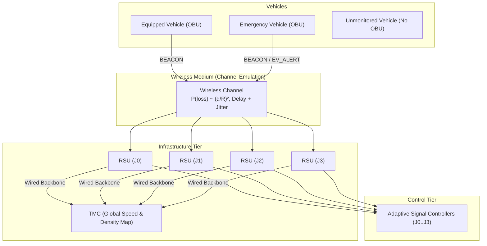
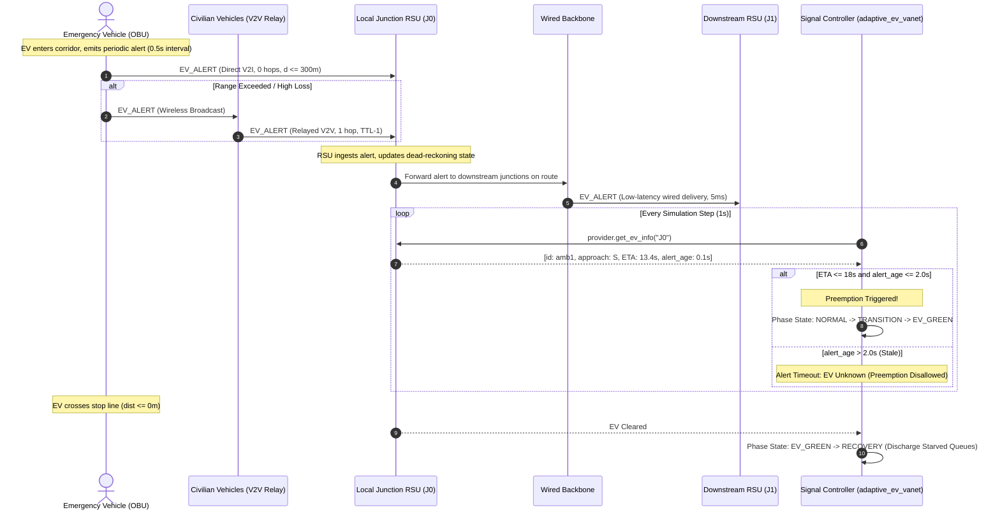
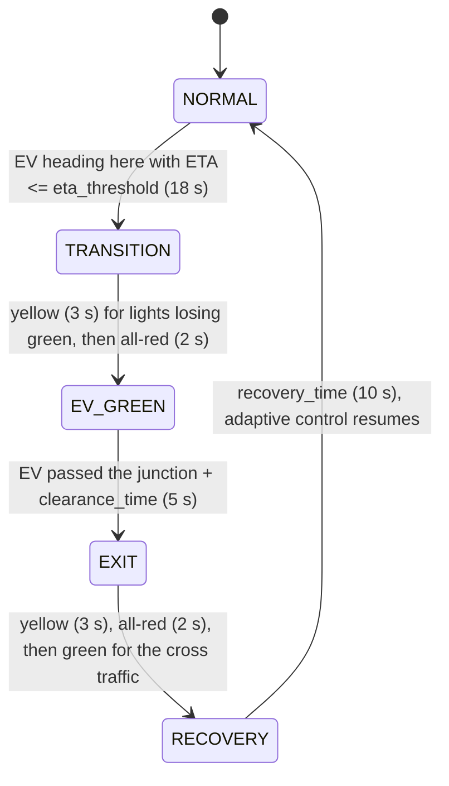
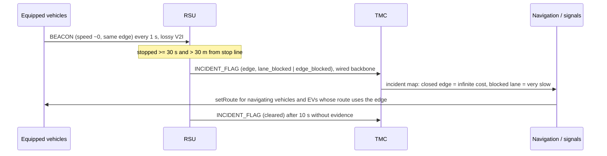

# VANET Emulation & Sensing Methodology

This document outlines the theoretical models, mathematical formulations, and engineering limitations of the emulated Vehicular Ad-Hoc Network (VANET) layer supporting adaptive traffic signal control and navigation.

---

## 1. Architecture Overview

The system architecture decouples the microscopic mobility simulation (SUMO via TraCI/libsumo) from the traffic signal controllers via a dedicated **Sensing Abstraction Layer** (`sim/sensing.py`). The communication topology consists of three primary entities:

1. **On-Board Units (OBUs)**: Mounted on vehicles. Emergency vehicles have guaranteed 100% equipment. For general vehicles, equipment is determined by a deterministic, seed-derived cryptographic hash against the configured penetration rate:
   $$\text{Equipped}(v) = \left[ \frac{\text{SHA256}(\text{seed} \,\|\, \text{"obu:"} \,\|\, v)[0..8]}{2^{32} - 1} < \text{penetration} \right]$$
2. **Roadside Units (RSUs)**: Co-located at each signalized intersection ($J_0, J_1, J_2, J_3$). Each RSU maintains a localized RF coverage area ($R = 300\,\text{m}$), listens for periodic `BEACON` messages, estimates approach queues and speeds, and communicates with the Traffic Management Center (TMC).
3. **Traffic Management Center (TMC)**: Aggregates localized RSU estimates across a wired, lossless backbone (fixed small delay $\delta_{\text{backbone}}$) to construct a global network traffic map.

### 1.1 Signal controllers in plain language

- **Fixed-time** (`fixed`): north-south green 30 s, yellow 3 s, all-red 2 s, then east-west green 30 s, and so on.
- **Adaptive** (`adaptive`, `adaptive_vanet`): every `decision_interval` (5 s) the controller compares the queues of the two directions, as reported by its StateProvider.
  - A green lasts at least `min_green` (10 s) and at most `max_green` (50 s).
  - It switches early when the waiting direction's queue is larger by at least `queue_threshold` (5 vehicles), when the served direction is empty, or when a waiting approach has been red for `starvation_limit` (60 s).
  - An approach whose incoming road is fully blocked by an incident counts as having no demand.
  - The two versions run the same rule. `adaptive` reads true queues from SUMO; `adaptive_vanet` reads queues the RSU estimated from beacons.
- **Safety, all controllers:** a change of green always goes green, then yellow, then all-red, then the new green. Every phase the controller sets is held until the controller changes it, so SUMO's own program never switches behind it. Every applied state is checked for conflicting greens.

---

## 2. Wireless Channel Model

The wireless channel (`sim/vanet/channel.py`) models transmission success, packet loss, and propagation delay without relying on heavy external network simulators (e.g., OMNeT++ / ns-3).

### 2.1 Distance-Dependent Quadratic Path Loss
Wireless packet delivery is constrained by a maximum transmission range $R$. Within the boundary $d \le R$, the probability of packet loss increases quadratically with distance:

$$P(\text{loss} \mid d) = \begin{cases} 
\text{base\_loss} + (\text{max\_loss} - \text{base\_loss}) \cdot \left(\frac{d}{R}\right)^2 & \text{for } d \le R \\
1.0 & \text{for } d > R 
\end{cases}$$

The Packet Delivery Ratio (PDR) as a function of Euclidean distance $d$ is:
$$\text{PDR}(d) = 1.0 - P(\text{loss} \mid d)$$

### 2.2 Stochastic Delay & Jitter
Transmission delay incorporates both baseline network stack traversal and random jitter:
$$\text{delay}_{\text{ms}} = \text{base\_delay\_ms} + U(0, \text{jitter\_ms})$$
$$\text{delivery\_time} = t_{\text{transmit}} + \frac{\text{delay}_{\text{ms}}}{1000}$$

Packets are stored in a priority delivery queue and released precisely on the simulation step covering $\text{delivery\_time}$. No message can be accessed or inspected prior to its delivery timestamp.

---

## 3. RSU Approach State Estimation

Controllers operating under the `adaptive_vanet` policy do not possess access to direct TraCI state queries (e.g. `lane.getLastStepHaltingNumber`). Instead, the `RSUNode` derives queue and speed estimates exclusively from delivered `BEACON` messages.

### 3.1 Approach Queue Estimation
For each incoming approach $d \in \{N, S, E, W\}$:
1. Filter active beacons received on approach lanes/edges within the spatial queue zone ($L_{\text{queue}} \le 100\,\text{m}$).
2. Filter for halting/crawling vehicles ($v \le v_{\text{threshold}} = 1.0\,\text{m/s}$).
3. Scale the observed equipped count by the inverse penetration rate:
   $$\hat{Q}_d(t) = \operatorname{round}\left( \frac{\sum_{v \in \mathcal{V}_d} \mathbb{I}(v \le v_{\text{threshold}} \land \text{dist}(v, \text{RSU}) \le L_{\text{queue}})}{\max(\text{penetration}, 0.01)} \right)$$

### 3.2 Stale Beacon Pruning
To prevent stale telemetry from generating phantom queues during green discharge, beacons older than $\tau_{\text{stale}} = 3.0\,\text{s}$ are automatically discarded:
$$\text{Active}(b) = [t_{\text{current}} - t_{\text{arrival}}(b) \le \tau_{\text{stale}}]$$

### 3.3 Accuracy Metric
The accuracy of the VANET sensing tier is tracked via Mean Absolute Error (MAE) evaluated against the ground truth oracle across all controlled junctions:
$$\text{MAE}_{\text{queue}} = \frac{1}{T \cdot |\mathcal{J}| \cdot 4} \sum_{t=1}^T \sum_{j \in \mathcal{J}} \sum_{d \in \{N,S,E,W\}} |Q_{j,d}^{\text{true}}(t) - \hat{Q}_{j,d}^{\text{est}}(t)|$$

---

## 4. Engineering Limitations

To ensure scientific honesty and transparency, the following design boundaries must be stated:

1. **No MAC-Layer Contention Modeling**:
   - The channel emulation evaluates point-to-point and broadcast links probabilistically. It does not model IEEE 802.11p EDCA / CSMA/CA backoff slots, hidden-terminal collisions, or frame-level physical interference.
2. **Simplified Propagation Physics**:
   - Path loss follows a deterministic quadratic curve rather than multi-path Nakagami-$m$, Rayleigh, or Two-Ray Ground fading models. Obstacles such as urban building shadowing are not ray-traced.
3. **Co-located RSUs**:
   - RSUs are assumed to be stationed at intersection poles with omnidirectional antennas. RSU placement optimization is omitted as all junctions require individual signal controllers on the 2x2 grid.

---

## 5. VANET Emergency Vehicle Preemption & Message Flow (Module 8)

Under the `adaptive_ev_vanet` controller policy, signal preemption operates without oracle access to SUMO TraCI ground truth. Instead, emergency preemption is driven purely by distributed V2I, V2V relay, and infrastructure backbone messages.

### 5.1 Communication Topology & Message Types

1. **`EV_ALERT` Generation**:
   The emergency vehicle's OBU broadcasts an `EvAlertMessage` periodically every $\Delta t_{\text{alert}} = 0.5\,\text{s}$. The payload contains:
   - Vehicle ID (`ev_id`)
   - Sending timestamp ($t_{\text{alert}}$)
   - Real-time kinematic coordinates $(x, y)$
   - Instantaneous speed ($v$)
   - Complete route edge list ($\mathcal{R}_{\text{edges}}$)
   - Time-to-Live (`ttl = 3`) and Hop Count (`hops = 0`)

2. **Direct V2I Transmission**:
   RSUs positioned within the EV's direct line-of-sight RF range ($d \le R$) receive the alert subject to channel loss $P(\text{loss} \mid d)$ and stochastic delay $\text{delay}_{\text{ms}}$.

3. **V2V Multi-Hop Relaying (`--relay on`)**:
   When direct single-hop communication is blocked or attenuated by distance ($d > R$):
   - Nearby equipped civilian vehicles ($v_{\text{civ}}$) within range of the EV ingest the alert.
   - Using per-node duplicate suppression on `msg_id`, each vehicle re-broadcasts the alert exactly once with decremented TTL (`ttl - 1`) and incremented hop count (`hops + 1`).
   - The relayed packet reaches downstream RSUs that were originally beyond the single-hop horizon.

4. **Wired Infrastructure Backbone**:
   Upon ingesting an alert (via direct V2I or V2V relay), the receiving RSU inspects $\mathcal{R}_{\text{edges}}$:
   - For all downstream signalized junctions along the EV's path, the alert is forwarded across the high-speed wired backbone with fixed latency $\delta_{\text{backbone}} = 5.0\,\text{ms}$ and zero packet loss.
   - Downstream controllers look ahead and prepare signal transitions prior to the EV entering their local RF radius.

### 5.2 RSU Dead-Reckoning & Alert Expiry

When a controller queries `provider.get_ev_info(tls_id)` at time $t$:
1. **Age Threshold**: The alert age $\tau_{\text{age}} = t - t_{\text{alert}}$ is evaluated. If $\tau_{\text{age}} > \tau_{\text{timeout}} = 2.0\,\text{s}$, the alert is expired and dropped. Preemption immediately aborts to avoid green trap hazards.
2. **Dead-Reckoning Extrapolation**:
   $$d_{\text{extrap}}(t) = \max\left(0.0,\, \text{dist}(\text{pos}_{\text{alert}},\, \text{RSU}) - v \cdot \tau_{\text{age}}\right)$$
3. **Queue-Blocked Velocity Compensation**:
   If an ambulance is trapped behind a red-light queue ($v < 1.0\,\text{m/s}$ and $d \le 150\,\text{m}$), an uncompensated ETA calculation $d/v \to \infty$ would fail to trigger preemption. The RSU applies a nominal cruising speed fallback $v_{\text{cruise}} = 15.0\,\text{m/s}$:
   $$\text{ETA}(t) = \frac{d_{\text{extrap}}(t)}{\max(v, 15.0 \text{ if } v < 1.0 \text{ else } 0.1)}$$

### 5.3 Sequence Diagram

### 5.4 Preemption state machine (ambulance-only green)

- **Trigger.** An EV that will cross this junction within the next two signalised junctions on its route, with ETA below `eta_threshold`. ETA is the distance along the route divided by its speed. Several EVs: the lowest ETA is served first.
- **EV_GREEN.** Only the EV's approach is green, for all its movements: straight, left and right. Every other approach is red. With a whole-direction green, cars ahead of the EV that turn left must wait for gaps in oncoming traffic and block the EV. On the grid this held an ambulance for about 16 s at a green light in the road-closure scenario. With an approach-only green the queue in front of the EV clears at once. Across 12 runs (road closure, heavy navigation demand, single junction), the ambulance did not stop once after this change.
- **Safe changes.** Every change is computed from the current signal state. Lights losing green show yellow, an all-red interval comes before any light gains green, and a yellow already showing also gets its full yellow time. The unit test `sim/tests/test_ev_only_green.py` checks this sequence and that no conflicting greens appear.
- **Information source.**
  - `adaptive_ev` uses true EV positions (oracle).
  - `adaptive_ev_vanet` uses only EV_ALERTs received by the junction's RSU. It dead-reckons the distance along the route, and an alert older than `alert_timeout` (2 s) means "no EV".
- **Missed preemption.** An EV drove through a junction whose preemption never triggered for it.

---

## 6. Vehicular Navigation: A* and Ant Colony Optimization (Module 9)

Module 9 implements dynamic route navigation over the SUMO edge-connectivity graph (`sim/navigation/graph.py`), where dynamic edge costs are derived from TMC traffic speed maps built by the VANET layer:
$$\text{Cost}(e) = \frac{\text{length}(e)}{\max(\bar{v}(e), v_{\min})} + d_J \cdot [e \text{ ends at a traffic light}]$$

- $\bar{v}(e)$ is the TMC speed of edge $e$, **smoothed** with an exponential filter (time constant `navigation.speed_smoothing_s` = 60 s, about one signal cycle). An edge without reports relaxes towards its free-flow speed. Edges in the TMC incident map use the raw value, so incidents take effect at once.
- $d_J$ (`navigation.junction_delay_s` = 8 s) is the expected wait at a traffic light. It is the mean wait per signal measured in the navigation scenario (about 16 s per trip over two signals). Without it a detour through extra signals looks as cheap as its driving time alone. Because $d_J \ge 0$, the A\* heuristic still never overestimates the remaining cost (it stays admissible).
- A vehicle switches route only if the new route is at least 5% cheaper (hysteresis) than the rest of its current route. Both costs leave out the edge the vehicle is on, since it is the same for every alternative.

Section 10.1 explains why these three rules were added.

### 6.1 Equivalence of A* with Zero Heuristic to Dijkstra
In $A^*$ search, the priority evaluation function is:
$$f(n) = g(n) + h(n)$$
where $g(n)$ is the accumulated cost from the start node and $h(n)$ is the heuristic estimate to the goal.
When $h(n) = 0$ for all nodes $n \in \mathcal{V}$:
$$f(n) = g(n) + 0 = g(n)$$
The evaluation function degenerates strictly to the accumulated path cost. Consequently, the priority queue orders nodes purely by their current shortest distance from the origin, which is the exact definition of Dijkstra's algorithm. In `sim/navigation/astar.py`, setting `heuristic="zero"` reproduces Dijkstra with mathematical precision, expanding all equidistant frontier nodes. Setting `heuristic="euclid"` provides an admissible, consistent heuristic:
$$h(u) = \frac{\text{dist}(u, \text{goal})}{v_{\max}}$$
Since $v(e) \le v_{\max}$, $h(u) \le \text{true remaining travel time}$, directing the frontier toward the target and reducing node expansions without sacrificing optimality.

### 6.2 Mitigating the "Herding" Phenomenon with Ant Colony Optimization (ACO)
Deterministic shortest-path algorithms (like $A^*$ or Dijkstra) suffer from the **traffic herding phenomenon**: when an edge experiences a minor delay, every navigating vehicle simultaneously switches to the single next-best alternative corridor. This abruptly shifts congestion to the alternative road, triggering severe oscillations.

Ant Colony Optimization (`sim/navigation/aco.py`) solves this by returning the top-$K$ distinct paths with **selection probabilities**:
$$P(\text{Path}_i) = \frac{\frac{1}{\text{Cost}(\text{Path}_i)}}{\sum_{j=1}^K \frac{1}{\text{Cost}(\text{Path}_j)}}$$
Each navigating vehicle samples among the candidate paths according to $P(\text{Path}_i)$. Instead of 100% of vehicles stampeding onto the single best detour, traffic naturally splits across the alternative corridors in proportion to their travel time efficiency, stabilizing network-wide edge load variance ($\text{CV}_{\text{load}}$).

### 6.3 Topology Constraints of a 2x2 Grid Network
On a 2x2 signalized grid network:
- Pure diagonal origin-destination movements (e.g. `bottom0J0` to `top1J3`) offer exactly two primary orthogonal paths of equal length:
  1. Route A: `bottom0J0 -> J0J1 -> J1J3 -> J3top1` (via East first)
  2. Route B: `bottom0J0 -> J0J2 -> J2J3 -> J3top1` (via North first)
- Straight-through movements along an avenue (e.g. `bottom0J0` to `top0J2`) have only one direct route. Any detour incurs two extra turning penalties and crosses perpendicular signal phases.
- Thus, the benefits of dynamic navigation are concentrated primarily on diagonal high-volume OD flows, while the total number of feasible topological alternatives remains naturally constrained compared to large-scale city grids.

---

## 7. Incidents Detected Through VANET (Module 10)

### 7.1 Simulated incidents (ground truth)
`sim/scenarios/incident.py` creates two incident types on the 2x2 grid (default: edge `J0J1`, 150 s to 330 s):

- **stop**: one vehicle breaks down in one lane. Other lanes stay open.
- **closure**: every lane is blocked (a crash). Vehicles already on the edge behind the blockage wait until it reopens.

Blocking vehicles are inserted with `traci.vehicle.add`, held with `setStop`, and removed when the incident ends. They are excluded from trip metrics. Lane permissions are not changed, because SUMO aborts when a running vehicle's route becomes invalid.

**Baseline behaviour (`local_detour`)**: a driver who reaches the edge just before a closure sees it, and SUMO reroutes that vehicle. This applies to every vehicle, so navigation is compared with "drivers react only when they see the blockage".

### 7.2 Detection rule (RSU)
Each RSU tracks, from the beacons it receives, how long each equipped vehicle has been stopped (speed <= `queue_speed_threshold`) on the same edge. It raises an `INCIDENT_FLAG` for an edge when at least `incident_min_vehicles` vehicles have been stopped there for `incident_detect_time` (30 s) and are more than `incident_stopline_exclusion_m` (30 m) from the edge's downstream end.

The distance rule separates incidents from red-light queues. At a red light the vehicles that wait longest are at the stop line. In grid runs with adaptive control, no vehicle more than 30 m from the stop line stayed stopped longer than 27 s. Fixed-time control on the congested grid can keep vehicles stopped for up to 66 s through spillback, which would produce false flags, so `incident_false_flags` is reported.

If stopped vehicles are seen in every lane, the flag is `edge_blocked`; otherwise it is `lane_blocked`. The RSU clears its flag after `incident_clear_time` (10 s) without evidence. Lane counts and edge end points come from the static map, not from live sensing.

### 7.3 Message flow

### 7.4 How the system reacts
- **Navigation**: A* and ACO read the TMC incident map. A navigating vehicle whose remaining route uses a flagged edge is re-checked immediately, without waiting for its next reroute interval.
- **Emergency vehicles** (always equipped) are rerouted with A* around TMC-closed edges. Their EV_ALERTs carry the new route, so preemption follows it.
- **Signals**: the adaptive controller treats an approach whose incoming edge is fully blocked as having no demand, so it gives no green and no starvation credit to traffic that cannot move. VANET controllers learn this from the TMC map; oracle controllers use the true incident (ideal baseline).

### 7.5 Limits
- At 1 Hz beacons the detection delay is at least `incident_detect_time` + about 3 s. Lowering the threshold detects faster but raises false flags at long reds.
- At low penetration the blocked vehicles may be unequipped. A closure can then be seen as only a lane blockage, and a single stopped car can be missed entirely (seen at penetration 0.2 and 0.3, seed 1).
- An incident within 30 m of the stop line is not detected by this rule.
- Signal masking covers only the blocked edge's own approach. Movements at the upstream junction that lead into the blocked edge are not masked.

---

## 8. Offline Parameter Tuning with a Genetic Algorithm (Module 11)

`sim/optimizer/ga_tuner.py` tunes parameters offline by running SUMO. The online controllers only read the resulting YAML file.

### 8.1 Two targets
| Target | Chromosome | Fitness (minimise) | Evaluated on |
|---|---|---|---|
| `signals` | min_green, max_green, queue_threshold, decision_interval, eta_threshold, alert_interval, beacon_interval | avg_waiting_time + w1 · ev_travel_time + w2 · missed_preemptions (+ penalty) | `adaptive_ev_vanet`, scenarios emergency and congested on grid2x2 |
| `aco` | alpha, beta, rho, n_ants, n_iterations, Q, elite_k | nav_avg_travel_time + w · edge_load_cv + penalty for route-search time above a limit | `adaptive_vanet` with `--nav aco`, nav-fraction 0.3, navigation scenario |

Both targets are tuned at one communication condition (penetration 0.5, loss 0.1, range 300 m), averaged over tuning seeds 101-103. Each run lasts `ga.eval_max_steps` (600 s) to keep tuning affordable.

**Constraints and guards**:
- `max_green` must exceed `min_green`, and `elite_k` must not exceed `n_ants`. A chromosome that breaks either gets `penalty × (1 + violation)` and is not simulated.
- A run in which the ambulance does not arrive gets a penalty. Otherwise its missing travel time would count as 0 and reward blocking it.
- A crashed run gets 10 × penalty.

### 8.2 Operators
- **Initial population**: the hand-set defaults from `config.yaml` plus random chromosomes. The GA therefore never returns something worse than the defaults on the tuning seeds.
- **Tournament selection** (size 3). **BLX-α blend crossover** (α = 0.5): each child gene is drawn uniformly from the parents' interval widened by α on each side.
- **Bounded Gaussian mutation**: σ = 0.15 × the gene's range, then clipped. Integer genes are rounded.
- **Elitism**: the best 2 survive unchanged.
- **Cache**: identical chromosomes are simulated once. The cache is saved to disk with the settings that produced it, so a rerun with the same settings resumes.
- **Parallelism**: a process pool in which each worker starts its own SUMO, with a private output directory.
- **Reproducibility**: all GA randomness comes from `ga.ga_seed`, and every simulation is seeded.

### 8.3 Avoiding overfitting
The GA optimises on seeds 101-103, which may simply fit those traffic samples. The tuned parameters are therefore compared with the defaults on **held-out seeds 1-10**, at the tuning condition and at other conditions (`ga.cross_conditions`, default penetration 0.8, loss 0.3). The report gives mean ± std fitness, percent improvement, how many seeds improved, and a paired Wilcoxon signed-rank p-value (`results/ga/ga_<target>_evaluation.md`).

### 8.4 Limits
- Fitness uses shortened runs (600 s), so tuned values are tuned for that horizon.
- The full evaluation (section 9) uses full-length runs, so tuned parameters are checked on a horizon they were not tuned for.
- `avg_waiting_time` counts finished trips only. A setting that holds vehicles until after the run ends is not fully penalised. The held-out table reports throughput so this can be checked.
- 12 × 12 is a small search for 7 genes. The result is an improvement over the defaults, not an optimum.

---

## 9. Evaluation Protocol (Module 12)

`sim/analytics/evaluate.py --suite signals|ev|nav|eco|all` runs every configuration on the 2x2 grid over seeds 1-10, with full-length runs (1000 s). The factors are listed under `evaluation:` in `config.yaml`.

| Suite | Scenarios | Configurations | Baseline |
|---|---|---|---|
| signals | normal, congested | fixed, adaptive (oracle), adaptive_vanet at penetration 0.2 / 0.5 / 0.8 / 1.0 | fixed |
| ev | emergency | fixed, adaptive, adaptive_ev (oracle), adaptive_ev_vanet at loss 0 / 0.1 / 0.3 / 0.5 x relay on/off (range 300), adaptive_ev_vanet_tuned at loss 0.1 | adaptive |
| nav | navigation, incident | adaptive_vanet with nav none, astar, aco, aco_tuned at fraction 0.1 / 0.3 / 0.5, penetration 1.0 and 0.5 | nav none at the same penetration |
| eco | normal, congested | fixed and adaptive_vanet with 0 / 30 / 60 / 100% eco cars (GLOSA), penetration 1.0 | the same controller with 0% eco cars |

**Pairing.** The same seed produces the same traffic demand in every configuration, so each configuration is compared with its baseline seed by seed.

**Statistics.** For each scenario, configuration and metric the summary gives:
- mean, standard deviation, and a 95% confidence interval (t-distribution, n-1 degrees of freedom);
- the percent improvement over the baseline, signed so that positive is better (lower times; higher throughput and PDR);
- a two-sided paired p-value: Wilcoxon signed-rank with at least 6 paired seeds, otherwise a paired t-test.

With 10 seeds the smallest possible Wilcoxon p-value is about 0.002. Many comparisons are made, so treat single p-values near 0.05 with caution; no multiple-comparison correction is applied.

**Bookkeeping.** Each run appends one row to `results/raw.csv`. A rerun skips finished rows and retries failed ones, so a long evaluation can be stopped and resumed. Configurations that need GA output are skipped with a warning until the tuned files exist. `--quick` uses 2 seeds, fewer factors and 400 s runs, and writes to `results/quick/`.

---

## 10. Corrections Made After Module 12

The quick evaluation showed EV preemption slowing the ambulance on the 2x2 grid. Three bugs caused it; all are fixed:

1. **EV distance and approach.** Both the oracle provider and the RSUs now measure the EV's distance **along its remaining route** to the junction's stop line, using static map data (edge lengths and end junctions). The approach is the direction of the edge the EV will **arrive on**. A junction that is not ahead on the route receives no EV information. Before the fix, junctions ahead used the EV's *current* lane for the approach (so they greened the wrong axis), and RSUs used straight-line distance (so a junction off the route, or one the EV had already passed, kept preempting). EV_ALERTs now carry the EV's route index and lane position, which the OBU knows.
2. **Inside a junction.** While the EV crosses junction J, SUMO may already report the next route edge. The junction being crossed is now read from the internal lane id. Before, the next junction wrongly concluded the EV had passed and ended its preemption early.
3. **SUMO advancing phases by itself.** The controllers set phases with `setPhase` but SUMO's static program kept running. After the net-file duration (30 s single junction, 42 s grid) SUMO switched to yellow and the next green behind the controller's back. Every controller-set phase is now held (`setPhaseDuration`) until the controller changes it.

`missed_preemptions` is now measured: the signalised junctions an EV drove through without that junction's preemption having triggered for it. It was previously always 0.

**Effect.** Fixed-time results are unchanged. Adaptive control improves (normal single junction, seed 1: waiting time 8.3 s to 3.8 s) because its greens are no longer cut at 30 s. The Module 4b regression baseline (`sim/tests/regression_baseline.json`) was re-recorded for this reason. On the grid, oracle and VANET preemption now cut EV travel time from 81.6 s to about 63 s (mean of seeds 1-5, 500 s runs), with 0 missed preemptions. All results in `results/` were regenerated after this fix: the VANET experiments, both GA targets and the evaluation. In the full evaluation (10 seeds, 1000 s runs, with ambulance-only green from section 5.4) the ambulance needs 65.2 s with oracle preemption and 64-69 s with VANET preemption, against 87.6 s with adaptive control alone.

### 10.1 Navigation cost model (found in the full evaluation)

The first full evaluation showed navigating vehicles **slower** than the others, even when only 10% of vehicles navigated, so herding could not explain it. On seed 1 with A\* at 10%, navigating cars drove 1140 m instead of 924 m, stopped 2.8 times instead of 2.1, and needed 135 s instead of 107 s. Three causes:

1. **Unequal comparison.** The current route's cost included the edge the car was on, while A\* and ACO leave out their start edge. A car queued at a red light (edge speed near 1 m/s, so about 230 s for that edge) therefore saw every alternative as about 230 s cheaper and switched.
2. **Red lights looked like jams.** The raw TMC speed of an approach drops near zero every red phase. Routes avoided whichever approach was red at that moment and chased greens around the block.
3. **Signals cost nothing.** A detour crosses extra signals, but only driving time was counted.

The fixes are in section 6: the current edge is left out of both costs, edge speeds are smoothed over about one cycle, and each signal on a route adds an expected wait. With them, on the same run, navigating cars drove 940 m and needed 100 s, against 106 s for the others. The ACO GA target and the navigation suite were rerun with the fixed model, and the earlier navigation numbers are superseded.

---

## 11. Eco-Driving with GLOSA (Green Light Optimal Speed Advisory)

**Idea.** Each RSU broadcasts its junction's Signal Phase and Timing (SPaT) over the same emulated, lossy V2I channel. An equipped "eco" car that knows when the light will turn green can slow down early and arrive just as it does. It avoids braking to a stop, idling and accelerating again, which is where most urban fuel is spent.

**SPaT from the controllers.** For each approach a controller publishes the current signal, the earliest and latest time until it changes, and the earliest and latest start of the next green.
- Fixed-time control knows these exactly.
- Adaptive control only knows bounds: a green cannot end before `min_green` and must end by `max_green` (plus one decision interval).
- During an EV preemption the timing is unknown and is published as such.

**Advice rule** (`sim/vanet/glosa.py`, every second, for the next signal within 300 m along the route):

| Advice | When | Effect |
|---|---|---|
| go | the car reaches the line before the green surely ends, or after the next green starts | none |
| slow | the next green start is known within 5 s | target speed = distance / (time to green + 1 s), at least 5 m/s |
| stop | the red lasts too long to bridge at 5 m/s | none: the car stops at the line normally |
| none | no fresh SPaT (older than 2.5 s), timing too uncertain, or preemption | none |

The speed is set with `traci.vehicle.setSpeed`. SUMO still keeps safe gaps and its acceleration limits, so following cars are slowed too, which is realistic. An earlier version also let cars creep at 3 m/s on uncertain adaptive timing. That made trips 33% longer and CO2 14% higher, so speed advice is now limited to timing that is known precisely.

**When no speed advice is given (added after testing in heavy traffic).**
- **Lane change pending.** The car is not yet in a lane that continues on its route (SUMO best-lane offset is not 0). Slowing such a car makes it miss the gap it needs. In the navigation scenario, two eco cars reached the J0 stop line each in the lane the other needed. They deadlocked (teleporting is disabled), and the queue spilled back through the grid: max queue 60 and throughput -19%. With this rule: max queue 13, throughput unchanged.
- **Queue ahead.** A vehicle within 60 m ahead is slower than 3 m/s. The queue, not the signal, then sets when the car reaches the line, and slowing it only wastes green time for the cars behind.

**Measurement.** Fuel and CO2 come from SUMO's emission device (HBEFA4, petrol passenger car Euro 4) in tripinfo. Stops are tripinfo `waitingCount`. Results are split into eco and non-eco cars. Fuel in litres assumes 745 g/L petrol.

**First results** (before the lane-change and queue rules; see below for the corrected seed-1 numbers) (normal demand, 2x2 grid, seeds 1-2, full runs):
- With fixed-time signals and 100% eco cars: CO2 per km fell about 9%, stops per vehicle about 62%, and travel time did not increase (it fell, because cars cross on green without start-up loss).
- With adaptive VANET signals, eco-driving has almost no effect either way: only about 1.5% of advice is "slow", because adaptive timing is rarely predictable to within 5 s.

**Corrected results** (with the lane-change and queue rules, seed 1, full runs):
- Normal demand, 100% eco cars: CO2 -3%, stops -35%, waiting time -28%, travel time -1%.
- Heavy navigation demand, 60% eco cars: CO2 -1%, stops -21%, waiting time -20%, throughput unchanged.

The CO2 saving is smaller than first measured because fewer cars get speed advice.

**10-seed evaluation** (`results/summary.md`, eco suite): with fixed-time signals and normal demand, 100% eco cars cut stops per vehicle 40%, waiting time 31% and CO2 2.9%, with travel time unchanged. In congestion stops fall 10%. With adaptive VANET signals all changes stay within ±2%. Discussion: `docs/results_discussion.md` section 4.

GLOSA and actuated control pull in different directions. One predicts the signal, the other changes it in response to traffic. Combining them (for example, an adaptive controller that commits to its next switch a few seconds ahead) is future work.

**Limits.**
- The emission model gives estimates, not measurements.
- The advisor knows the car's own route and position (as a navigation unit would) and sees the vehicle ahead (as radar would). It does not know the length of the queue at the stop line, so a slowed car may still reach the back of a queue that forms after the advice.
- Every advice update costs extra TraCI calls per eco car, so eco runs take several times longer to simulate.
