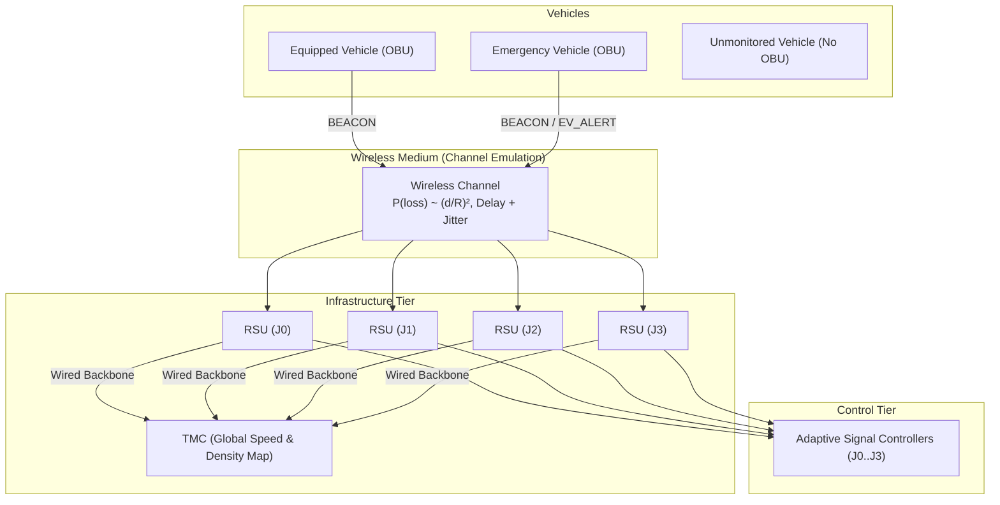
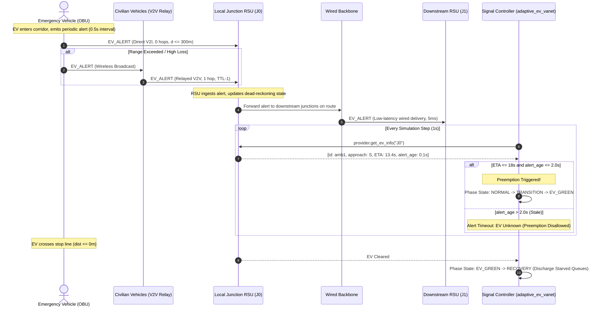

# VANET Emulation & Sensing Methodology

This document outlines the theoretical models, mathematical formulations, and engineering limitations of the emulated Vehicular Ad-Hoc Network (VANET) layer supporting adaptive traffic signal control and navigation.

---

## 1. Architecture Overview

The system architecture decouples the microscopic mobility simulation (SUMO via TraCI/libsumo) from the traffic signal controllers via a dedicated **Sensing Abstraction Layer** (`sim/sensing.py`). The communication topology consists of three primary entities:

1. **On-Board Units (OBUs)**: Mounted on vehicles. Emergency vehicles have guaranteed 100% equipment. For general vehicles, equipment is determined by a deterministic, seed-derived cryptographic hash against the configured penetration rate:
   $$\text{Equipped}(v) = \left[ \frac{\text{SHA256}(\text{seed} \,\|\, \text{"obu:"} \,\|\, v)[0..8]}{2^{32} - 1} < \text{penetration} \right]$$
2. **Roadside Units (RSUs)**: Co-located at each signalized intersection ($J_0, J_1, J_2, J_3$). Each RSU maintains a localized RF coverage area ($R = 300\,\text{m}$), listens for periodic `BEACON` messages, estimates approach queues and speeds, and communicates with the Traffic Management Center (TMC).
3. **Traffic Management Center (TMC)**: Aggregates localized RSU estimates across a wired, lossless backbone (fixed small delay $\delta_{\text{backbone}}$) to construct a global network traffic map.

---

## 2. Wireless Channel Model

The wireless channel (`sim/vanet/channel.py`) models transmission success, packet loss, and propagation delay without relying on heavy external network simulators (e.g., OMNeT++ / ns-3).

### 2.1 Distance-Dependent Quadratic Path Loss
Wireless packet delivery is constrained by a maximum transmission range $R$. Within the boundary $d \le R$, the probability of packet loss increases quadratically with distance:

$$P(\text{loss} \mid d) = \begin{cases} 
\text{base\_loss} + (\text{max\_loss} - \text{base\_loss}) \cdot \left(\frac{d}{R}\right)^2 & \text{for } d \le R \\
1.0 & \text{for } d > R 
\end{cases}$$

The Packet Delivery Ratio (PDR) as a function of Euclidean distance $d$ is:
$$\text{PDR}(d) = 1.0 - P(\text{loss} \mid d)$$

### 2.2 Stochastic Delay & Jitter
Transmission delay incorporates both baseline network stack traversal and random jitter:
$$\text{delay}_{\text{ms}} = \text{base\_delay\_ms} + U(0, \text{jitter\_ms})$$
$$\text{delivery\_time} = t_{\text{transmit}} + \frac{\text{delay}_{\text{ms}}}{1000}$$

Packets are stored in a priority delivery queue and released precisely on the simulation step covering $\text{delivery\_time}$. No message can be accessed or inspected prior to its delivery timestamp.

---

## 3. RSU Approach State Estimation

Controllers operating under the `adaptive_vanet` policy do not possess access to direct TraCI state queries (e.g. `lane.getLastStepHaltingNumber`). Instead, the `RSUNode` derives queue and speed estimates exclusively from delivered `BEACON` messages.

### 3.1 Approach Queue Estimation
For each incoming approach $d \in \{N, S, E, W\}$:
1. Filter active beacons received on approach lanes/edges within the spatial queue zone ($L_{\text{queue}} \le 100\,\text{m}$).
2. Filter for halting/crawling vehicles ($v \le v_{\text{threshold}} = 1.0\,\text{m/s}$).
3. Scale the observed equipped count by the inverse penetration rate:
   $$\hat{Q}_d(t) = \operatorname{round}\left( \frac{\sum_{v \in \mathcal{V}_d} \mathbb{I}(v \le v_{\text{threshold}} \land \text{dist}(v, \text{RSU}) \le L_{\text{queue}})}{\max(\text{penetration}, 0.01)} \right)$$

### 3.2 Stale Beacon Pruning
To prevent stale telemetry from generating phantom queues during green discharge, beacons older than $\tau_{\text{stale}} = 3.0\,\text{s}$ are automatically discarded:
$$\text{Active}(b) = [t_{\text{current}} - t_{\text{arrival}}(b) \le \tau_{\text{stale}}]$$

### 3.3 Accuracy Metric
The accuracy of the VANET sensing tier is tracked via Mean Absolute Error (MAE) evaluated against the ground truth oracle across all controlled junctions:
$$\text{MAE}_{\text{queue}} = \frac{1}{T \cdot |\mathcal{J}| \cdot 4} \sum_{t=1}^T \sum_{j \in \mathcal{J}} \sum_{d \in \{N,S,E,W\}} |Q_{j,d}^{\text{true}}(t) - \hat{Q}_{j,d}^{\text{est}}(t)|$$

---

## 4. Engineering Limitations

To ensure scientific honesty and transparency, the following design boundaries must be stated:

1. **No MAC-Layer Contention Modeling**:
   - The channel emulation evaluates point-to-point and broadcast links probabilistically. It does not model IEEE 802.11p EDCA / CSMA/CA backoff slots, hidden-terminal collisions, or frame-level physical interference.
2. **Simplified Propagation Physics**:
   - Path loss follows a deterministic quadratic curve rather than multi-path Nakagami-$m$, Rayleigh, or Two-Ray Ground fading models. Obstacles such as urban building shadowing are not ray-traced.
3. **Co-located RSUs**:
   - RSUs are assumed to be stationed at intersection poles with omnidirectional antennas. RSU placement optimization is omitted as all junctions require individual signal controllers on the 2x2 grid.

---

## 5. VANET Emergency Vehicle Preemption & Message Flow (Module 8)

Under the `adaptive_ev_vanet` controller policy, signal preemption operates without oracle access to SUMO TraCI ground truth. Instead, emergency preemption is driven purely by distributed V2I, V2V relay, and infrastructure backbone messages.

### 5.1 Communication Topology & Message Types

1. **`EV_ALERT` Generation**:
   The emergency vehicle's OBU broadcasts an `EvAlertMessage` periodically every $\Delta t_{\text{alert}} = 0.5\,\text{s}$. The payload contains:
   - Vehicle ID (`ev_id`)
   - Sending timestamp ($t_{\text{alert}}$)
   - Real-time kinematic coordinates $(x, y)$
   - Instantaneous speed ($v$)
   - Complete route edge list ($\mathcal{R}_{\text{edges}}$)
   - Time-to-Live (`ttl = 3`) and Hop Count (`hops = 0`)

2. **Direct V2I Transmission**:
   RSUs positioned within the EV's direct line-of-sight RF range ($d \le R$) receive the alert subject to channel loss $P(\text{loss} \mid d)$ and stochastic delay $\text{delay}_{\text{ms}}$.

3. **V2V Multi-Hop Relaying (`--relay on`)**:
   When direct single-hop communication is blocked or attenuated by distance ($d > R$):
   - Nearby equipped civilian vehicles ($v_{\text{civ}}$) within range of the EV ingest the alert.
   - Using per-node duplicate suppression on `msg_id`, each vehicle re-broadcasts the alert exactly once with decremented TTL (`ttl - 1`) and incremented hop count (`hops + 1`).
   - The relayed packet reaches downstream RSUs that were originally beyond the single-hop horizon.

4. **Wired Infrastructure Backbone**:
   Upon ingesting an alert (via direct V2I or V2V relay), the receiving RSU inspects $\mathcal{R}_{\text{edges}}$:
   - For all downstream signalized junctions along the EV's path, the alert is forwarded across the high-speed wired backbone with fixed latency $\delta_{\text{backbone}} = 5.0\,\text{ms}$ and zero packet loss.
   - Downstream controllers look ahead and prepare signal transitions prior to the EV entering their local RF radius.

### 5.2 RSU Dead-Reckoning & Alert Expiry

When a controller queries `provider.get_ev_info(tls_id)` at time $t$:
1. **Age Threshold**: The alert age $\tau_{\text{age}} = t - t_{\text{alert}}$ is evaluated. If $\tau_{\text{age}} > \tau_{\text{timeout}} = 2.0\,\text{s}$, the alert is expired and dropped. Preemption immediately aborts to avoid green trap hazards.
2. **Dead-Reckoning Extrapolation**:
   $$d_{\text{extrap}}(t) = \max\left(0.0,\, \text{dist}(\text{pos}_{\text{alert}},\, \text{RSU}) - v \cdot \tau_{\text{age}}\right)$$
3. **Queue-Blocked Velocity Compensation**:
   If an ambulance is trapped behind a red-light queue ($v < 1.0\,\text{m/s}$ and $d \le 150\,\text{m}$), an uncompensated ETA calculation $d/v \to \infty$ would fail to trigger preemption. The RSU applies a nominal cruising speed fallback $v_{\text{cruise}} = 15.0\,\text{m/s}$:
   $$\text{ETA}(t) = \frac{d_{\text{extrap}}(t)}{\max(v, 15.0 \text{ if } v < 1.0 \text{ else } 0.1)}$$

### 5.3 Sequence Diagram

---

## 6. Vehicular Navigation: A* and Ant Colony Optimization (Module 9)

Module 9 implements dynamic route navigation over the SUMO edge-connectivity graph (`sim/navigation/graph.py`), where dynamic edge costs are derived from TMC traffic speed maps built by the VANET layer:
$$\text{Cost}(e) = \frac{\text{length}(e)}{\max(\text{speed}(e), v_{\min})}$$

### 6.1 Equivalence of A* with Zero Heuristic to Dijkstra
In $A^*$ search, the priority evaluation function is:
$$f(n) = g(n) + h(n)$$
where $g(n)$ is the accumulated cost from the start node and $h(n)$ is the heuristic estimate to the goal.
When $h(n) = 0$ for all nodes $n \in \mathcal{V}$:
$$f(n) = g(n) + 0 = g(n)$$
The evaluation function degenerates strictly to the accumulated path cost. Consequently, the priority queue orders nodes purely by their current shortest distance from the origin, which is the exact definition of Dijkstra's algorithm. In `sim/navigation/astar.py`, setting `heuristic="zero"` reproduces Dijkstra with mathematical precision, expanding all equidistant frontier nodes. Setting `heuristic="euclid"` provides an admissible, consistent heuristic:
$$h(u) = \frac{\text{dist}(u, \text{goal})}{v_{\max}}$$
Since $v(e) \le v_{\max}$, $h(u) \le \text{true remaining travel time}$, directing the frontier toward the target and reducing node expansions without sacrificing optimality.

### 6.2 Mitigating the "Herding" Phenomenon with Ant Colony Optimization (ACO)
Deterministic shortest-path algorithms (like $A^*$ or Dijkstra) suffer from the **traffic herding phenomenon**: when an edge experiences a minor delay, every navigating vehicle simultaneously switches to the single next-best alternative corridor. This abruptly shifts congestion to the alternative road, triggering severe oscillations.

Ant Colony Optimization (`sim/navigation/aco.py`) solves this by returning the top-$K$ distinct paths with **selection probabilities**:
$$P(\text{Path}_i) = \frac{\frac{1}{\text{Cost}(\text{Path}_i)}}{\sum_{j=1}^K \frac{1}{\text{Cost}(\text{Path}_j)}}$$
Each navigating vehicle samples among the candidate paths according to $P(\text{Path}_i)$. Instead of 100% of vehicles stampeding onto the single best detour, traffic naturally splits across the alternative corridors in proportion to their travel time efficiency, stabilizing network-wide edge load variance ($\text{CV}_{\text{load}}$).

### 6.3 Topology Constraints of a 2x2 Grid Network
On a 2x2 signalized grid network:
- Pure diagonal origin-destination movements (e.g. `bottom0J0` to `top1J3`) offer exactly two primary orthogonal paths of equal length:
  1. Route A: `bottom0J0 -> J0J1 -> J1J3 -> J3top1` (via East first)
  2. Route B: `bottom0J0 -> J0J2 -> J2J3 -> J3top1` (via North first)
- Straight-through movements along an avenue (e.g. `bottom0J0` to `top0J2`) have only one direct route. Any detour incurs two extra turning penalties and crosses perpendicular signal phases.
- Thus, the benefits of dynamic navigation are concentrated primarily on diagonal high-volume OD flows, while the total number of feasible topological alternatives remains naturally constrained compared to large-scale city grids.

