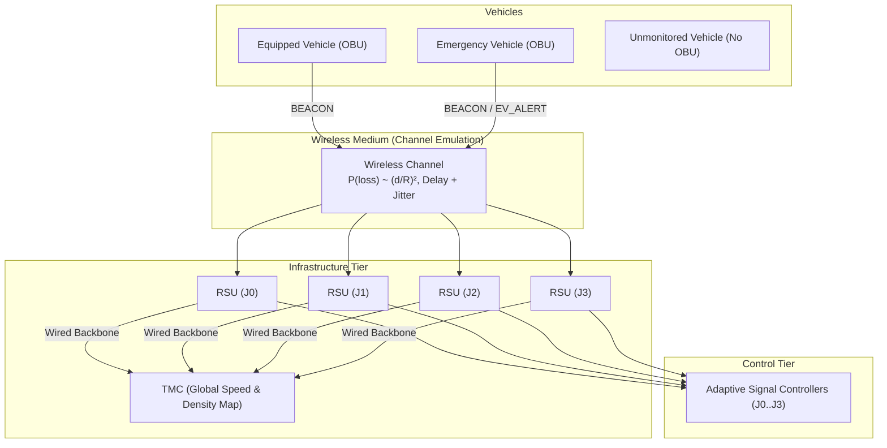

# VANET Emulation & Sensing Methodology

This document outlines the theoretical models, mathematical formulations, and engineering limitations of the emulated Vehicular Ad-Hoc Network (VANET) layer supporting adaptive traffic signal control and navigation.

---

## 1. Architecture Overview

The system architecture decouples the microscopic mobility simulation (SUMO via TraCI/libsumo) from the traffic signal controllers via a dedicated **Sensing Abstraction Layer** (`sim/sensing.py`). The communication topology consists of three primary entities:

1. **On-Board Units (OBUs)**: Mounted on vehicles. Emergency vehicles have guaranteed 100% equipment. For general vehicles, equipment is determined by a deterministic, seed-derived cryptographic hash against the configured penetration rate:
   $$\text{Equipped}(v) = \left[ \frac{\text{SHA256}(\text{seed} \,\|\, \text{"obu:"} \,\|\, v)[0..8]}{2^{32} - 1} < \text{penetration} \right]$$
2. **Roadside Units (RSUs)**: Co-located at each signalized intersection ($J_0, J_1, J_2, J_3$). Each RSU maintains a localized RF coverage area ($R = 300\,\text{m}$), listens for periodic `BEACON` messages, estimates approach queues and speeds, and communicates with the Traffic Management Center (TMC).
3. **Traffic Management Center (TMC)**: Aggregates localized RSU estimates across a wired, lossless backbone (fixed small delay $\delta_{\text{backbone}}$) to construct a global network traffic map.

---

## 2. Wireless Channel Model

The wireless channel (`sim/vanet/channel.py`) models transmission success, packet loss, and propagation delay without relying on heavy external network simulators (e.g., OMNeT++ / ns-3).

### 2.1 Distance-Dependent Quadratic Path Loss
Wireless packet delivery is constrained by a maximum transmission range $R$. Within the boundary $d \le R$, the probability of packet loss increases quadratically with distance:

$$P(\text{loss} \mid d) = \begin{cases} 
\text{base\_loss} + (\text{max\_loss} - \text{base\_loss}) \cdot \left(\frac{d}{R}\right)^2 & \text{for } d \le R \\
1.0 & \text{for } d > R 
\end{cases}$$

The Packet Delivery Ratio (PDR) as a function of Euclidean distance $d$ is:
$$\text{PDR}(d) = 1.0 - P(\text{loss} \mid d)$$

### 2.2 Stochastic Delay & Jitter
Transmission delay incorporates both baseline network stack traversal and random jitter:
$$\text{delay}_{\text{ms}} = \text{base\_delay\_ms} + U(0, \text{jitter\_ms})$$
$$\text{delivery\_time} = t_{\text{transmit}} + \frac{\text{delay}_{\text{ms}}}{1000}$$

Packets are stored in a priority delivery queue and released precisely on the simulation step covering $\text{delivery\_time}$. No message can be accessed or inspected prior to its delivery timestamp.

---

## 3. RSU Approach State Estimation

Controllers operating under the `adaptive_vanet` policy do not possess access to direct TraCI state queries (e.g. `lane.getLastStepHaltingNumber`). Instead, the `RSUNode` derives queue and speed estimates exclusively from delivered `BEACON` messages.

### 3.1 Approach Queue Estimation
For each incoming approach $d \in \{N, S, E, W\}$:
1. Filter active beacons received on approach lanes/edges within the spatial queue zone ($L_{\text{queue}} \le 100\,\text{m}$).
2. Filter for halting/crawling vehicles ($v \le v_{\text{threshold}} = 1.0\,\text{m/s}$).
3. Scale the observed equipped count by the inverse penetration rate:
   $$\hat{Q}_d(t) = \operatorname{round}\left( \frac{\sum_{v \in \mathcal{V}_d} \mathbb{I}(v \le v_{\text{threshold}} \land \text{dist}(v, \text{RSU}) \le L_{\text{queue}})}{\max(\text{penetration}, 0.01)} \right)$$

### 3.2 Stale Beacon Pruning
To prevent stale telemetry from generating phantom queues during green discharge, beacons older than $\tau_{\text{stale}} = 3.0\,\text{s}$ are automatically discarded:
$$\text{Active}(b) = [t_{\text{current}} - t_{\text{arrival}}(b) \le \tau_{\text{stale}}]$$

### 3.3 Accuracy Metric
The accuracy of the VANET sensing tier is tracked via Mean Absolute Error (MAE) evaluated against the ground truth oracle across all controlled junctions:
$$\text{MAE}_{\text{queue}} = \frac{1}{T \cdot |\mathcal{J}| \cdot 4} \sum_{t=1}^T \sum_{j \in \mathcal{J}} \sum_{d \in \{N,S,E,W\}} |Q_{j,d}^{\text{true}}(t) - \hat{Q}_{j,d}^{\text{est}}(t)|$$

---

## 4. Engineering Limitations

To ensure scientific honesty and transparency, the following design boundaries must be stated:

1. **No MAC-Layer Contention Modeling**:
   - The channel emulation evaluates point-to-point and broadcast links probabilistically. It does not model IEEE 802.11p EDCA / CSMA/CA backoff slots, hidden-terminal collisions, or frame-level physical interference.
2. **Simplified Propagation Physics**:
   - Path loss follows a deterministic quadratic curve rather than multi-path Nakagami-$m$, Rayleigh, or Two-Ray Ground fading models. Obstacles such as urban building shadowing are not ray-traced.
3. **Co-located RSUs**:
   - RSUs are assumed to be stationed at intersection poles with omnidirectional antennas. RSU placement optimization is omitted as all junctions require individual signal controllers on the 2x2 grid.
